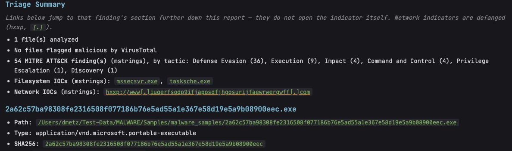
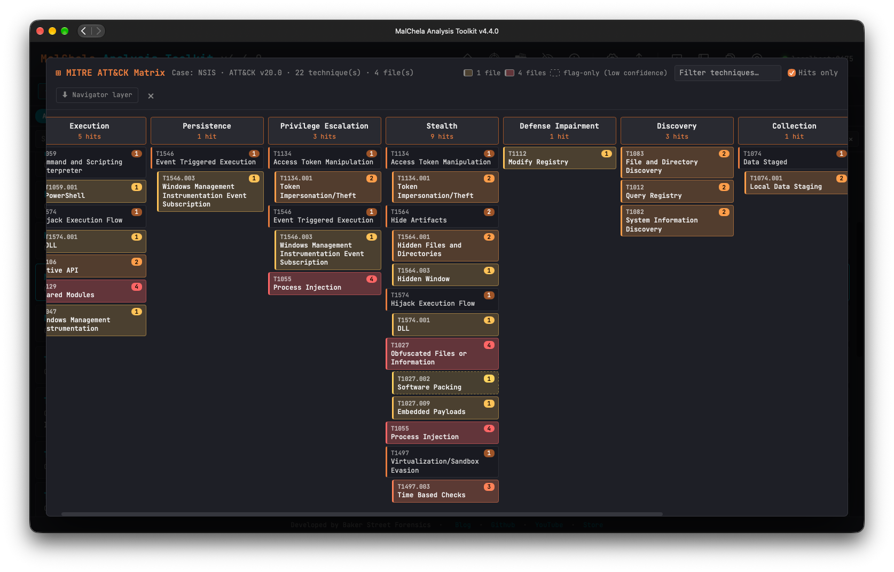

Analyze is a one-click auto-triage workflow: point it at a file, folder, `.app` bundle, `.dmg`, or `.pkg`, and it classifies everything with [File Miner](fileminer.md), then automatically dispatches every tool File Miner suggests for each file it finds. There's no need to read File Miner's suggestions and run each tool by hand — Analyze closes that loop for you and produces a single combined report at the end.

Unlike the other Core Tools, Analyze is not a standalone Rust binary — it's a workflow built on top of the existing tools, available through the **PWA** and the **MCP server**.

---

### How It Works

1. If the target is a `.dmg` or `.pkg`, [dpp Extract](../mac/dpp_extract.md) unwraps it first (UDIF → HFS+/APFS → XAR → PBZX/CPIO) and Analyze continues against the extracted files. A `.zip` (the only way to get a directory-based sample like an `.app` bundle through the web interface's file-only upload widget) is auto-extracted the same way.
2. File Miner scans the target (a single file, every file in a folder, or every file inside an `.app` bundle or extracted container) and classifies each one. A `.zip`/`.dmg`/`.pkg` found **mid-scan** — not just as the top-level target, e.g. a sample that's simply a lone archive sitting in its own folder — is extracted the same way and its contents folded into the same run, breadth-first (an archive nested inside an extracted archive also gets unwrapped), capped at 5 nested extractions per run as a guard against zip bombs or pathological nesting.
3. Every executable (PE, ELF, Mach-O) is run through [Unpack](unpack.md). When it recovers payloads — a UPX-decompressed binary (including tampered UPX), fat Mach-O slices, PyInstaller entry scripts, Costura assemblies, installer contents, carved overlays or embedded executables — each payload is classified by File Miner and added to the run as a file of its own, marked **Unpacked from** its parent in the rollup. Clean executables add nothing.
4. For each file, Analyze runs every tool File Miner suggests — the same suggestions you'd see running File Miner manually, just dispatched automatically instead of one at a time.
5. Results are combined into a single **MalChela Summary** rollup report (`malchela_summary_<timestamp>.md`), saved alongside the individual tool reports it summarizes.

A single sample or small bundle is the intended use case — Analyze auto-dispatches up to 25 files per run. For corpus-scale scans, use [MZHash](mzhash.md), [MZCount](mzcount.md), or [XMZHash](xmzhash.md) instead.

**Over the 25-file cap** (routine for a dpp-extracted `.pkg` payload — a trojanized installer commonly bundles the full legitimate app it trojanized alongside the injected malicious file(s); EvilQuest's sample is 624 files for one Mach-O of actual interest), Analyze doesn't error out or auto-run everything:

- **PWA:** hands off to [File Miner](fileminer.md)'s own interactive table, pointed at the extracted target — real per-row "run this tool" buttons instead of a static summary.
- **MCP:** returns a file listing directly as text (extension mismatches first, then up to 40 more with a note to call File Miner directly for the rest), since there's no browser to redirect an AI agent to — it can act on the listing immediately.

---

### The MalChela Summary Rollup Report

The rollup is laid out in the order of Lenny Zeltser's [Malware Analysis Report](https://zeltser.com/malware-analysis-report) template (bundled in `assets/report_templates/`), so it lines up section for section with a written report.  It fills the evidence sections only.  Executive Summary, a family confidence call, MBC behaviors, What We Don't Know, and Infection Vector need an analyst's judgment, and a mechanical rollup that filled them would read as conclusions nobody drew, so they're left for the written report.  The MCP plugin's `report_template` and `save_report` tools build that report from the case.

| Section | Source | What It Shows |
|---------|--------|----------------|
| Sample Snapshot | Threat Intel Query, FileAnalyzer, Unpack, Code Sign Check | Threat intel family names and tags with the source behind each; VirusTotal verdicts (cross-referenced from FileAnalyzer and Threat Intel Query, so Mach-O samples get the same coverage as PE); target platform and architecture; the primary artifact's SHA-256; packing and obfuscation; a revoked Developer ID certificate when `--check-revocation` finds one; file counts, with duplicate content (identical SHA-256 under different names) grouped into one write-up |
| Component Inventory | Unpack, File Miner | One row per file: its role (primary artifact, or a recovered payload and how it was recovered), file type, and notes such as **unpacked from** its parent |
| Capabilities | mStrings, Unpack, tool flags | One row per ATT&CK technique: tactics, the rules or flags behind it, and the files that hit it, plus the rule-hit count and a pointer to the interactive matrix (see below).  These are rule hits: evidence to corroborate, not confirmed behavior.  Hits from a bundler's bootloader or runtime describe the wrapper, not the sample.  Low-confidence flag mappings are marked |
| Indicators of Compromise | mStrings, hashes | The template's tiers: Hash Values (every file), IP Addresses, Domain Names, Network Artifacts (URLs), and Host Artifacts (dropped files and paths), each linked to the file it came from.  Network indicators are defanged (`hxxp://`, `[.]`).  Long lists are capped with a pointer to the full mStrings report |
| Analysis Details | Every tool | Tool flags (RPATH entries, hidden-Dock plists, Team ID mismatches, and similar) attributed to the file and tool, then each file's own section with every tool's formatted report.  MalChela is static only, so behavioral and memory analysis are marked as not performed |
| Appendix: Analysis Environment | Analyze | MalChela version, analysis depth (static only), the tools run and how many times, whether network lookups were on, the host, and when it ran |



Every filename and IOC in the rollup is a link that jumps straight to that finding's section further down the same report — not out to the indicator itself, which is exactly why network indicators are defanged: the link target is always an internal anchor, but the *displayed text* shouldn't read like a live, clickable URL regardless.

Each file's section embeds every tool's actual formatted report — real tables and headers pulled from each tool's own Markdown output, not raw console text. The rollup reads cleanly whether you're viewing it in the PWA or opening the file directly.
---

### MITRE ATT&CK Matrix

Unpack, recursive extraction, and the Mac tools mean a single Analyze run can produce ATT&CK findings from many files and several tools.  Analyze rolls all of them into one **Enterprise matrix** (ATT&CK v20 — Stealth and Defense Impairment in place of the retired Defense Evasion), saved next to the rollup:

```
mitre_matrix_<timestamp>.json      # drives the PWA's interactive matrix
navigator_layer_<timestamp>.json   # ATT&CK Navigator layer (format 4.5)
```



<p align="center"><strong> MITRE ATT&CK Matrix</p>

Techniques come from three sources:

| Source | Techniques |
|--------|------------|
| mStrings | Every `detections.yaml` rule hit, plotted under the tactics the rule specifies |
| Unpack | T1027.002 (Software Packing) and T1027.009 (Embedded Payloads) |
| Tool flags | Mach-O Info, Code Sign Check, Plist Analyzer, and File Analyzer flags mapped through [`assets/flag_attack_map.yaml`](https://github.com/dwmetz/MalChela/blob/main/assets/flag_attack_map.yaml) — for example `system()`/`popen()` imports → T1059.004, `LSUIElement` → T1564.003, a revoked certificate → T1553.002 |

Flag mappings carry a confidence: **high** when the flag is direct evidence of the technique, **low** when it's consistent with it but common in benign software too (ad-hoc signing, a stripped symbol table).  Low-confidence cells are drawn with a dashed border and score half.  Some flags are deliberately left unmapped — RPATH entries, ATS exceptions, and similar describe a weakness or a configuration, not adversary behavior.

A cell's score is the number of distinct files that hit the technique (duplicate content counts once), so a fat Mach-O whose two slices both hit a rule scores 2.

**In the PWA:**

- After a run, click **⊞ MITRE ATT&CK matrix** at the top of the results.
- For a saved case, click **⊞ MITRE** on the case card.  This combines every Analyze run in the case into one matrix, along with every standalone report saved to the case by a tool that emits techniques (mStrings, Unpack, Mach-O Info, Code Sign Check, Plist Analyzer, File Analyzer).  Analyze saves its tools' reports into the case too, so a finding already counted from a run isn't counted again from its report.  Older cases work as well: the matrix is rebuilt from each run's summary and each tool report, so a case saved before the matrix existed still gets one.
- **Hits only** shows just the tactics and techniques with findings; turn it off for the full Enterprise matrix with hits highlighted in place.  Sub-technique hits are nested under their parent.
- Click a hit to see every file, tool, and rule or flag behind it, with links to MITRE Lookup and attack.mitre.org.  mStrings hits list the matched strings (as in the mStrings report: up to eight per rule, URLs and IPs defanged).
- **⬇ Navigator layer** downloads the layer for the run or the combined case; open it in [ATT&CK Navigator](https://mitre-attack.github.io/attack-navigator/) with **Open Existing Layer → Upload from local**.

---

### Save to Case

Analyze's Save to Case control matches every other tool panel — a checkbox and case dropdown, opt-in. When enabled, every tool Analyze dispatches saves its report to the case (and registers it in `case.yaml`, so it shows up in the case browser), and the rollup itself is saved to:

```
saved_output/cases/<case_name>/analyze/
```

When no case is selected, individual tool reports still land in their normal default locations (e.g. `saved_output/mstrings/`), and the rollup is saved to:

```
saved_output/analyze/
```

Analyze dispatches nsrlquery, Threat Intel Query, and FileAnalyzer's VirusTotal check automatically along with everything else — with [Offline Mode](../configuration/offline-mode.md) enabled, those tools skip their network call cleanly and the rollup still completes normally, just without the results that require connectivity.

**IP reputation.**  After mStrings runs, Analyze looks up the first five standalone public IP IOCs with [Threat Intel Query](tiquery.md) (VirusTotal, AlienVault OTX, and GreyNoise, whichever have keys).  It adds each result next to the IP in the summary's Indicators of Compromise table, flagged with ⚠ when VirusTotal engines detect it or GreyNoise classifies it as malicious.  IP Address Lists and public DNS resolvers are never looked up.  The cap keeps a run inside a free VirusTotal key's limits (4 lookups a minute, 500 a day).  Set `MALCHELA_IP_LOOKUPS` to change it, or to `0` to turn lookups off.  Each lookup is saved to the case as `tiquery/ip_<address>_<timestamp>.md`, and the Analysis Environment appendix records how many IPs were looked up and how many weren't.  Offline Mode skips it.

Analyze also passes [Code Sign Check](../mac/codesign_check.md)'s `--check-revocation` flag automatically, scoped to each sample's top-level binary only (not embedded frameworks/plugins/XPC helpers — a single bundle can carry dozens of those, each of which would otherwise trigger its own OCSP query and slow the run down considerably). Like the other network-dependent tools above, this is skipped automatically with Offline Mode enabled.

---

### PWA Usage

Click the **Analyze** button in the top toolbar, choose a file, folder, `.app` bundle, `.dmg`, or `.pkg`, then configure the run before clicking **Run**:

- **Save to Case** — opt-in, same pattern as every other tool panel.
- **Concise Output** — on by default. Renders the MalChela Summary rollup inline instead of the full expanded per-tool output. Turn it off to see everything each tool produced without opening the saved report separately.

There's also a shortcut straight from [File Miner](fileminer.md)'s results table: each row's **Analyze** button runs every suggested tool for that one file and produces the same rollup, without going through the toolbar button first.

---

### MCP Usage

Analyze is available to AI agents as the `analyze` tool in the MCP server. Like every other MCP tool, it requires an active case first — call `set_case` before `analyze`. This keeps the MCP's behavior consistent across all of its tools rather than special-casing this one workflow; there's no "no case" mode on the MCP side the way there is in the PWA.

`dpp_extract` is also exposed as its own MCP tool, for when an agent needs the extracted files without Analyze's auto-dispatch — `analyze` calls it automatically when pointed at a `.dmg`/`.pkg`, so calling it directly first isn't necessary for the normal triage flow.

See [`.claude-plugin/mcp/README.md`](https://github.com/dwmetz/MalChela/blob/main/.claude-plugin/mcp/README.md) for MCP setup.
