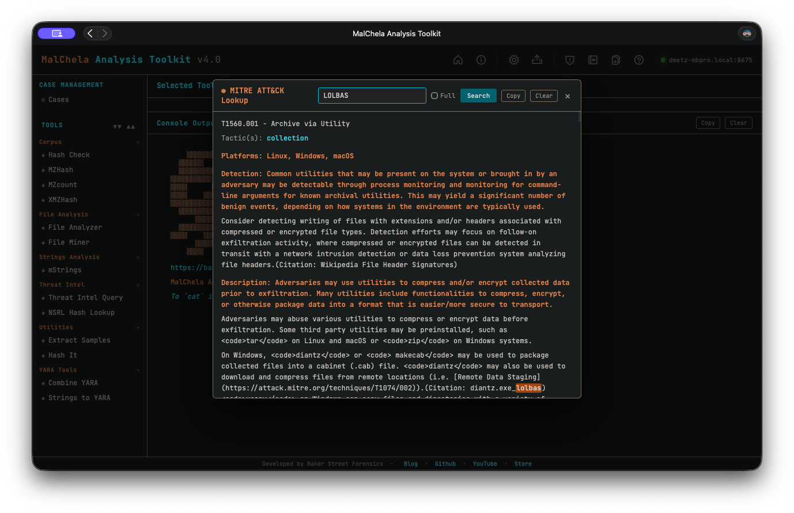
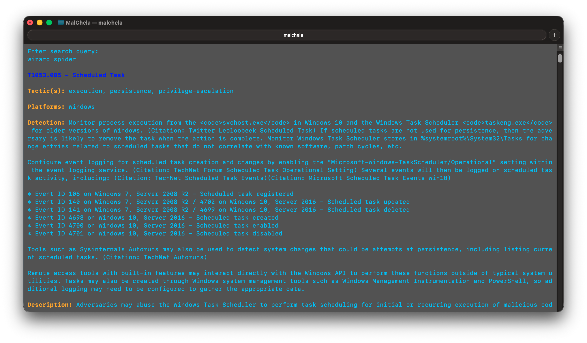

The MITRE Reference Panel provides a built-in way to explore MITRE ATT&CK techniques directly within MalChela.

This panel supports live search by **technique ID** (e.g., `T1059`) or **keyword** (e.g., "scripting"). It is context-aware and optimized for use alongside tools like `mstrings`.

# MITRE Lookup Panel

## Features

- Full display of technique details:
  - **Technique title**
  - **Tactic(s)**
  - **Platforms**
  - **Description**
  - **Detection guidance**
  - **Malware**
  - **Tools**
  - **Intrusion Sets**


- Modal view floats above the main console, allowing uninterrupted output viewing
- --full option to support long-form content (no truncation)
- Save lookups for later reference or save to a Case
- Markdown formatting for MITRE reports for inclusion in forensics reports

## Accessing from the MalChela Web Interface:

- Select **MITRE Lookup** in the left-hand **Toolbox** menu
- Use the input field at the top of the modal to enter a keyword or technique ID (e.g., `T1059` or `registry`)
- Use the "Full" checkbox for un-truncated output



<p align="center"><strong> MITRE Lookup</p>

## Accessing from CLI

There are two ways to use the MITRE Lookup from the command line:

### 1. From the main MalChela CLI menu

Run the MalChela CLI interface and select `MITRE Lookup` from the Toolbox section:

```bash
cargo run -p malchela
```

Then choose `MITRE Lookup` (or press `ml`) from the menu.

### 2. Direct tool execution

You can run the MITRE Lookup tool directly with a search term or flags:

```bash
# Basic search by keyword or technique ID
./target/release/MITRE_lookup -- t1027.004

# Use --full to display untruncated results
./target/release/MITRE_lookup --full -- t1027.004
```


<p align="center"><strong> MITRE Lookup (CLI)</p>

## Example

Searching for `T1027.004` yields:

```
MITRE ATT&CK Enterprise v20.0

T1027.004 - Compile After Delivery
Tactic(s): stealth
Platforms: Linux, macOS, Windows
Detection: Detection strategies: Detection Strategy for Compile After Delivery - Source Code to Executable Transformation (DET0501)
Description: Adversaries may attempt to make payloads difficult to discover and analyze by delivering files to victims as uncompiled code. Text-based...
```

## Tactics

Tactics have their own entries.  Look one up by ID (`TA0002`), by name (`execution`, `command and control`), or by shortname (`command-and-control`) to see its description and every technique under it, with sub-technique counts:

```
TA0002 - Execution (tactic)
Description: The adversary is trying to run malicious code or instructions on a system. ...
Techniques (22 techniques, 44 sub-techniques):
- T1047 Windows Management Instrumentation
- T1053 Scheduled Task/Job (+5 sub-techniques)
- T1059 Command and Scripting Interpreter (+13 sub-techniques)
...
```

- `tactics` lists all 15 Enterprise tactics in matrix order, with technique counts.
- `--full` expands every sub-technique under its parent.
- `TA0005` or `defense evasion` shows both Stealth (TA0005) and Defense Impairment (TA0112), with a note on the v20 split.

Tactic data lives in `assets/mitre_tactics.json`, which `scripts/build_mitre_techniques.py` writes alongside the technique data.

## ATT&CK Version

The lookup data (`assets/mitre_techniques.json`) is built from MITRE's official ATT&CK STIX release, currently **Enterprise v20.0**. The version is shown at the top of every lookup.

- **ATT&CK v20 tactic change:** the Defense Evasion tactic was retired.  TA0005 is now **Stealth** (hiding, obfuscation, masquerading), and a new tactic, **Defense Impairment** (TA0112), covers disabling or tampering with security tools, logging, and firewalls.  Searching `defense evasion` (or `TA0005`) returns techniques from both, with a note.  Tactic searches ignore hyphens, so `defense impairment` matches `defense-impairment`.
- **Deprecated techniques still resolve:** looking up a retired ID such as `T1562.001` shows it marked deprecated, with its replacement (`T1685 Disable or Modify Tools`).  Current techniques are listed before deprecated ones.
- **Detection field:** ATT&CK v18 replaced per-technique detection text with Detection Strategies, so for current techniques the Detection line lists the strategy names and IDs (`DET…`).

### Updating to a new ATT&CK release

```bash
# Rebuild the technique and tactic data from the latest Enterprise release (or --version 20.0, or --bundle <file> offline)
python3 scripts/build_mitre_techniques.py

# Then migrate detections.yaml mappings (tactics, renamed/revoked techniques, tags),
# passing the previous dataset so author-chosen tactics are preserved
git show HEAD:assets/mitre_techniques.json > /tmp/mitre_old.json
python3 scripts/migrate_detections_attack.py --old /tmp/mitre_old.json --dry-run   # review
python3 scripts/migrate_detections_attack.py --old /tmp/mitre_old.json
```
