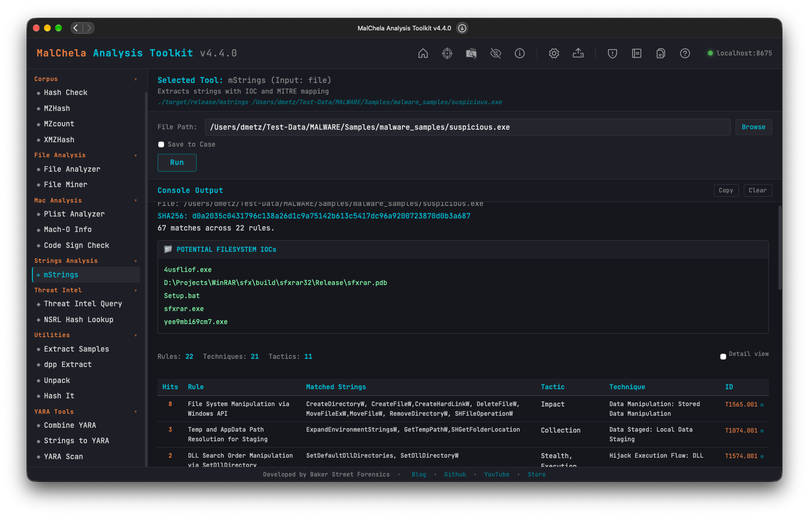

mStrings extracts strings from files and classifies them using regular expressions, YARA rules, and MITRE ATT&CK mappings. It highlights potential indicators of compromise and suspicious behavior, grouping matches by tactic and technique. Ideal for quickly surfacing malicious capabilities in binaries, scripts, and documents.

Also accepts macOS Mach-O binaries and `.app` bundles — when given a bundle, the main executable is auto-resolved via `Info.plist`'s `CFBundleExecutable`, falling back to the sole binary in `Contents/MacOS/` if that lookup fails.

Note: The MITRE Technique Lookup bar, introduced in v3.0.1 has been removed. It has been replaced with a full [MITRE lookup utility](mitre_lookup.md) (no internet required.)

### IOC Extraction

Alongside the Sigma-style detection matches, mStrings pulls out well-formed **Potential Filesystem IOCs** and **Potential Network IOCs** into their own report sections — paths, URLs, domains, and IPs found either as standalone strings or embedded in a longer one (a command line, a query string). Reserved/documentation IP ranges (loopback, broadcast, RFC 5737 test ranges, and similar) are excluded automatically, since they show up constantly in any binary's networking stack but are never real indicators.

**Network IOCs are shown defanged** (`http://` → `hxxp://`, every `.` → `[.]`) everywhere mStrings displays them — CLI output, saved reports, and the [Analyze](analyze.md) rollup that embeds them. This is deliberate: a raw URL rendered as clickable-looking text is the wrong thing to put in front of an analyst repeatedly. If you need the real string back — to build a YARA rule, for example — [Strings to YARA](strings_to_yara.md) automatically refangs any defanged line before it becomes a rule.

### IP Address Lists

When ten or more IP addresses are stored together, each as a string of its own, within a few hundred bytes of each other (a tuple in a Python stealer, a table in a binary's data section), mStrings reports them as one **IP Address List** instead of as individual Network IOCs.  Such a run is most often an anti-analysis blocklist of sandbox and analysis-host IPs the sample checks for before it runs (Luna Grabber carries 59), and sometimes a pool of C2 servers.  Either way, it isn't 59 separate C2 indicators.  The list keeps every address (defanged) and its offset range, so you can look the addresses up or check the code around them.  An IP inside a longer string, such as a command line, always stays a standalone Network IOC.

Public DNS resolvers (Google, Cloudflare, Quad9, and others) are also listed separately, as **Public DNS Resolvers Referenced (not C2)**.

### Multi-Layer Obfuscation

mStrings recursively decodes base64 content it finds — including base64 nested inside base64, up to 12 layers deep — and re-runs detection against whatever it unwraps to. When a detection only fires after peeling **more than one** layer, that's flagged directly on the finding (`⚠ found after N layers of base64 decoding` in the summary table, `Base64×N` in the detail table's encoding column) — a single decode is routine, but deliberate re-encoding multiple times over is itself an evasion signal worth noting.

### Encoded String Tables

Some malware keeps its entire payload as hundreds or thousands of encrypted, base64-alphabet strings and decodes them at runtime — the AMOS stealer stores its whole AppleScript this way, about 1,900 strings in one section.  Per-string matches are noise at that scale, and the real behavior never appears as plaintext, so no other rule fires.  When the large-base64-blob rule matches 25 or more distinct strings, mStrings adds one **Encoded string table** row instead: how many strings, their total size, their share of the file, and the offset range they span, mapped to T1027.013 (Encrypted/Encoded File).  Treat it as a pointer to dynamic analysis or a family-specific decoder rather than a dead end.



<p align="center"><strong> MStrings</p>

---

### 🔧 CLI Syntax

```bash
# Example 1: Scan a file
cargo run -p mstrings -- /path_to_file/

# Example 2: Save output as .txt
cargo run -p mstrings -- /path_to_file/ -o -t

# Example 3: Save output to a case folder
cargo run -p mstrings -- /path_to_file/ -o -t --case CaseXYZ

# Example 4: Scan a .app bundle (main executable resolved automatically)
cargo run -p mstrings -- /path/to/Sample.app
```

Use `-o` to save output and include one of the following format flags:
- `-t` → Save as `.txt`
- `-j` → Save as `.json`
- `-m` → Save as `.md`

If no file is provided, the tool will prompt you to enter the path interactively.

When `--case` is used, output is saved to:

```
saved_output/cases/CaseXYZ/mstrings/
```

Otherwise, results are saved to:

```
saved_output/mstrings/
```

> The MITRE Lookup feature is only available in the web interface version of mStrings.
