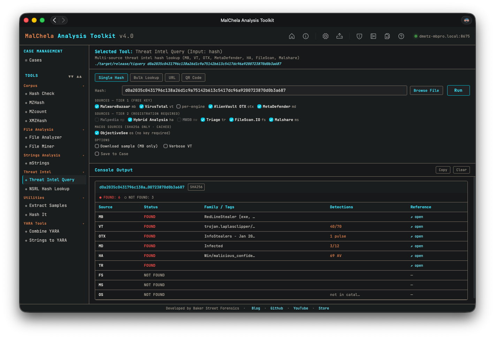
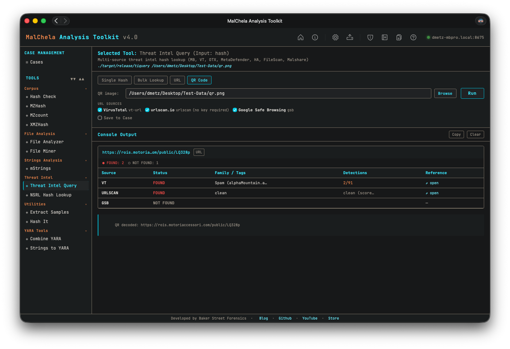

Threat Intel Query (`tiquery`) is a multi-source threat intelligence lookup tool. It queries multiple threat intelligence platforms in parallel and presents results in a unified table — giving analysts a fast, consolidated view of whether a hash, IP address, or URL is known, what family/category it belongs to, and how widely it has been detected.

`tiquery` accepts a **file hash** (MD5/SHA1/SHA256), an **IP address** (IPv4 or IPv6, defanged forms like `1[.]2[.]3[.]4` accepted), an **http/https URL**, or a **QR code image** as input and automatically routes the query to the appropriate set of sources. In the web interface, the Single Hash tab also includes a **Browse** button — pick any file and the SHA256 is computed and submitted automatically (the file itself is never uploaded, only its hash).



<p align="center"><strong> TIQuery Hash Lookup</p>



<p align="center"><strong> TIQuery QR Code Lookup</p>

---

### Supported Sources — Hash Lookups

| ID  | Source           | Tier | Key Required |
|-----|------------------|------|--------------|
| mb  | MalwareBazaar    | 1    | Optional     |
| vt  | VirusTotal       | 1    | Yes          |
| otx | AlienVault OTX   | 1    | Yes          |
| md  | MetaDefender     | 1    | Yes          |
| ha  | Hybrid Analysis  | 2    | Yes          |
| fs  | FileScan.IO      | 2    | Yes          |
| ms  | Malshare         | 2    | Yes          |
| tr  | Triage (RF)      | 2    | Yes          |
| os  | Objective-See    | 2    | No (SHA256 only) |

### Supported Sources — URL Lookups

| ID      | Source                  | Key Required |
|---------|-------------------------|--------------|
| vt      | VirusTotal (URL API)    | Yes          |
| urlscan | urlscan.io              | Optional (raises rate limits). **Opt-in**, see below |
| gsb     | Google Safe Browsing    | Yes          |

### Supported Sources — IP Lookups

| ID  | Source           | Key Required | What it adds |
|-----|------------------|--------------|--------------|
| vt  | VirusTotal (IP API) | Yes | Engine detections, community reputation, AS owner, and country |
| otx | AlienVault OTX   | Yes          | Pulse count, AS, and country |
| gn  | GreyNoise (Community API) | Yes (free key works) | Whether the IP is a known internet scanner ("noise") or a known benign business service ("RIOT": cloud, CDN, public DNS), and GreyNoise's classification.  IPv4 only |

Private, loopback, link-local, multicast, documentation, and other non-routable addresses are refused before any source is queried, so they never spend rate-limited quota.  A free VirusTotal key allows 4 lookups a minute and 500 a day.

All sources with a configured API key are queried automatically. No flag is needed to enable Tier 2 sources — if the key file exists, the source is included. When the input is a URL or an IP address, only the sources for that input type are queried. Pass `--sources` to restrict the query to specific sources.

### Downloading samples

`-d` / `--download` (SHA256 only) saves the sample after the lookup:

1. **MalwareBazaar**, if it has the sample (needs `api/mb-api.txt`).
2. **Triage**, if MalwareBazaar doesn't have it or the download fails (needs `api/tr-api.txt`). Triage serves the raw file, so tiquery checks its SHA256 against the hash you asked for and then wraps it in a zip with the usual password before writing anything to disk.

Either way the result is `<first 16 of sha256>.zip`, password **`infected`**, in `saved_output/tiquery/downloads/` (or the case's `tiquery/downloads/` folder with `--case`). The sample is never written to disk unwrapped. Only public samples can be downloaded.

### Keyless sources are opt-in

Some sources need no API key. If they ran by default, every lookup would go to a third party without anyone deciding to send it. Sources that send what you look up (currently **urlscan.io**, which receives the full URL) are therefore **off until you opt in**. Objective-See stays on: it downloads its public catalogue and matches hashes locally, so nothing about your sample leaves the machine.

```bash
tiquery --enable-keyless urlscan     # opt in (saved)
tiquery --disable-keyless urlscan    # opt out (saved; also silences the notice)
tiquery https://example.com --sources urlscan   # one-off use without saving a choice
```

Until a choice is recorded, URL lookups print a short notice listing each opt-in source and what it receives. The choice is saved in `api/keyless_sources.txt` (`urlscan=on` / `urlscan=off`) and shared by the CLI, the web interface (the source checkbox, or Configuration → Keyless threat-intel sources), and the Claude plugin. Configuring an optional key for the source (for urlscan, `api/url-api.txt`) also counts as opting in unless you've opted out.

**urlscan.io with or without a key.** urlscan.io's search API answers both anonymous and authenticated requests, so its key is optional:

| | Without a key | With a key (free account) |
|---|---|---|
| Rate limit | Low; busy sessions may see `rate limited` errors | Higher |
| Results | Public scans only | Public scans, plus your own private scans |
| Attribution | Lookups are tied to your public IP address | Lookups are also tied to your urlscan.io account |

Either way, the full URL is sent and nothing is submitted for a new scan. If you're working a case where lookups shouldn't be attributable to you, leave urlscan opted out, run lookups from a dedicated analysis egress, or use Offline Mode. Offline Mode overrides everything.

URLs whose host is a private, loopback, or reserved IP address, a single-label name, or an internal suffix (`.local`, `.lan`, `.internal`, `.corp`, `.home.arpa`, and so on) are refused before any source is queried.

---

### 🔧 CLI Syntax

```bash
# Hash lookup — queries all hash sources with a configured API key
tiquery <hash>

# URL lookup — queries VirusTotal (URL) and Google Safe Browsing; urlscan.io too once opted in
tiquery https://example.com/path

# IP lookup — queries VirusTotal (IP), AlienVault OTX, and GreyNoise
tiquery 185.220.101.4
tiquery 185[.]220[.]101[.]4

# Restrict to specific sources
tiquery <hash> --sources mb,vt,md,ha,fs
tiquery https://example.com --sources vt,urlscan

# Include per-engine VirusTotal detections (hash mode)
tiquery <hash> --verbose-vt

# Output as JSON
tiquery <hash> --json

# Output as CSV
tiquery <hash> --csv

# Save text report
tiquery <hash> -o -t

# Save report to a case folder
tiquery <hash> -o -t --case Case123

# Download sample (SHA256 only): MalwareBazaar first, then Triage
tiquery <hash> -d

# Bulk lookup — process multiple hashes from a file
tiquery --bulk hashes.txt
tiquery --bulk hashes.csv --json
tiquery --bulk hashes.txt --csv

# QR code decode + URL lookup — extract URL from a QR image and query it
tiquery --qr screenshot.png
tiquery --qr qr_image.jpg --json
```

Accepts MD5, SHA1, and SHA256 hashes, or any `http://` / `https://` URL. If no input is provided, the tool will prompt interactively.

**Bulk mode** reads a `.txt` or `.csv` file and extracts all valid MD5/SHA1/SHA256 hashes (one per line, or mixed with other content). Each hash is queried sequentially with a short delay between requests to respect API rate limits. Results are displayed as a table per hash in human mode, or as a JSON array / CSV stream when `--json` / `--csv` is specified.

**QR mode** decodes a QR code image (PNG/JPG/GIF/BMP/WebP) and uses the extracted URL as input to the standard URL lookup pipeline. Useful for triaging quishing (QR phishing) samples from emails and screenshots without needing the web interface.

---

### Output

Results are presented in a matrix showing source, status, malware family/tags, detection summary, and a reference link:

```
  tiquery <hash> (SHA256)
  ────────  ────────────  ──────────────────────  ─────────────  ────────────────────────────────────────
  Source    Status        Family / Tags           Detections     Reference
  ────────  ────────────  ──────────────────────  ─────────────  ────────────────────────────────────────
  MB        FOUND         Emotet                  ...            https://bazaar.abuse.ch/sample/...
  VT        FOUND         Trojan.Emotet           58/72          https://virustotal.com/gui/file/...
  OTX       FOUND                                 4 pulses       https://otx.alienvault.com/...
  MD        NOT FOUND                                            -
```

---

### Saving Output

Use `-o` to save output and include one of the following format flags:

- `-t` → Save as `.txt`

When `--case` is used, output is saved to:

```
saved_output/cases/Case123/tiquery/
```

Otherwise, reports are saved to:

```
saved_output/tiquery/
```

---

### API Keys

`tiquery` uses the same `api/` key file convention as other MalChela tools. Each source reads from its own file:

```
api/vt-api.txt        # VirusTotal (used for both hash and URL lookups)
api/mb-api.txt        # MalwareBazaar
api/otx-api.txt       # AlienVault OTX
api/md-api.txt        # MetaDefender
api/ha-api.txt        # Hybrid Analysis
api/fs-api.txt        # FileScan.IO
api/ms-api.txt        # Malshare
api/tr-api.txt        # Triage
api/url-api.txt       # urlscan.io (optional — raises rate limits)
api/gsb-api.txt       # Google Safe Browsing
api/gn-api.txt        # GreyNoise (IP lookups; a free Community key works)
```

Keys can be managed via the **API Keys** panel in the MalChela web interface (Configuration menu → API Keys) or by placing the key directly in the appropriate file.

See [API Configuration](https://dwmetz.github.io/MalChela/configuration/api-configuration/) for details.

Note that `os` (Objective-See) has no API-key gate of its own — it queries a locally cached copy of the Objective-See malware catalogue (refreshed every 24h) and always attempts that fetch on a cache miss, regardless of which other keys are configured. In an air-gapped environment, enable [Offline Mode](../configuration/offline-mode.md) to skip every source's network call, keyed or not.

---

### Bulk Lookup

Bulk lookup processes a `.txt` or `.csv` file containing hashes (one per line, or mixed with other content — the tool extracts valid MD5/SHA1/SHA256 values automatically) and runs all lookups in a single operation.

**CLI:** use the `--bulk <file>` flag (see CLI Syntax above). Results are printed as a table per hash, or as a combined JSON array / CSV when `--json` / `--csv` is specified.

**Web interface:** the TIquery panel's **Bulk Lookup** tab lets you browse to a file and run all lookups in one click. Results are displayed in a consolidated grid.

---

### Web Interface Input Modes

The MalChela web interface's Threat Intel Query panel offers five input modes, selected via tabs at the top of the panel:

- **Single Hash** — paste a hash or click **Browse…** to pick a file; the web interface computes the file's SHA256 and populates the hash field automatically.
- **Bulk Lookup** — as described above, for batches of hashes in a file.
- **URL** — paste an `http://` or `https://` URL to query VirusTotal, Google Safe Browsing, and (once opted in) urlscan.io in parallel. The urlscan.io checkbox reflects your saved choice, and toggling it saves the new choice.
- **IP** — paste an IPv4 or IPv6 address (defanged is fine: `1.2.3[.]4`) to query VirusTotal, AlienVault OTX, and GreyNoise.  Because an IP being *known* to a source isn't a verdict (8.8.8.8 is in every one), each row shows what that source concluded instead of FOUND: **FLAGGED** (VirusTotal engines or a GreyNoise malicious scanner), **IN *N* PULSES** (OTX: discussed, which is context), or **CLEAN** / **KNOWN BENIGN** (no engine detections, or a GreyNoise RIOT business service such as a CDN or public DNS).
- **QR Code** — pick a QR code image (PNG/JPG/GIF/BMP/WebP); the web interface decodes the embedded URL and populates the URL field for review, then runs the standard URL lookup pipeline. Useful for triaging "quishing" (QR phishing) samples from emails and screenshots.

In URL, IP, and QR modes, source checkboxes auto-enable based on which API keys are configured, exactly as in hash mode.
