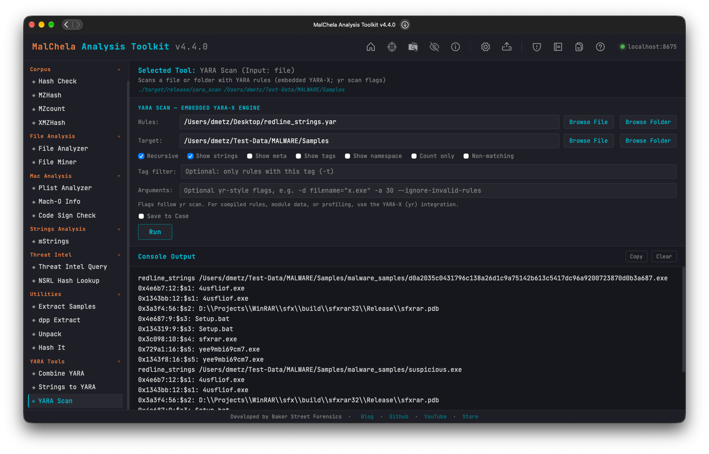

YARA Scan runs YARA rules against a file or folder on MalChela's embedded YARA-X engine, the same engine the other MalChela tools use.  Nothing extra to install.  Its command line follows VirusTotal's `yr scan`: the same arguments, flag names, and output formats, so a command written for one runs on the other.

YARA Scan covers the options used in day-to-day scanning.  For everything else, such as compiled rules or module data, install `yr` and use the [YARA-X integration](../tools/yara-x.md).



<p align="center"><strong> YARA Scan</p>

---

### 🔧 CLI Syntax

```bash
./target/release/yara_scan [OPTIONS] [NAMESPACE:]RULES_PATH... TARGET_PATH
```

- **`RULES_PATH`** is a `.yar` / `.yara` file or a folder.  Folders are walked recursively for `.yar` and `.yara` files.  Give more than one to combine rule sets, and prefix one with `NAME:` to put its rules in that namespace (`mal:rules/`).
- **`TARGET_PATH`** is the file or folder to scan.  Without `-r`, only the files directly in a folder are scanned.

```bash
# Scan a folder of samples, recursively, showing matching strings and tags
./target/release/yara_scan -r -s -g rules/ samples/

# Two rule sets in their own namespaces, with an external variable
./target/release/yara_scan -e -d filename=\"invoice.exe\" mal:rules/malware/ pup:rules/pup/ sample.exe

# Machine-readable output
./target/release/yara_scan -r -o ndjson -s -m rules/ samples/

# Save a Markdown report into a case
./target/release/yara_scan -r -s --case Acme --save rules/ samples/
```

### Supported `yr scan` Options

| Option | Description |
|---|---|
| `-c`, `--count` | Print only the number of matching rules per file |
| `-d`, `--define VAR=VALUE` | Define an external variable.  `VALUE` is an integer, float, `true`/`false`, or a quoted string (`-d name=\"x\"`) |
| `--disable-console-logs` | Accepted for compatibility.  `console` module output is never printed |
| `-w`, `--disable-warnings` | Don't print compiler warnings |
| `-e`, `--print-namespace` | Print each rule's namespace |
| `-g`, `--print-tags` | Print each rule's tags |
| `--ignore-invalid-rules` | Skip rule files that fail to compile, and report them as warnings |
| `-I`, `--ignore-module MODULE` | Ignore rules that use this module |
| `--include-dir PATH` | Extra directory to search for `include`d files.  Each rule file's own folder is always searched |
| `--max-matches-per-pattern N` | Cap the matches recorded per pattern |
| `-n`, `--negate` | Print the rules that did *not* match |
| `-o`, `--output-format FORMAT` | `text` (default), `ndjson` (one JSON object per file), or `json` (one document) |
| `--path-as-namespace` | Use each rule file's path as its namespace |
| `-m`, `--print-meta` | Print rule metadata |
| `-s`, `--print-strings[=N]` | Print each matching string with its offset and length, limited to `N` characters (default 120) |
| `-r`, `--recursive[=MAX_DEPTH]` | Scan subfolders of the target, optionally limited in depth (`-r=2`) |
| `--relaxed-re-syntax` | Accepted for compatibility.  Relaxed regular-expression parsing is always on, so rules written for libyara compile |
| `--scan-list` | `TARGET_PATH` is a text file listing the paths to scan, one per line |
| `-z`, `--skip-larger SIZE` | Skip files larger than `SIZE` bytes |
| `-t`, `--tag TAG` | Report only rules tagged `TAG` |
| `-p`, `--threads N` | Number of scanning threads (default: one per core) |
| `-a`, `--timeout SECONDS` | Abort a file's scan after this many seconds |

`-r` and `-s` take their optional value with `=` (`-r=2`, `-s=40`), so `-r rules/ samples/` never reads `rules/` as a depth.  `yr` works the same way.

### Not Supported: Use `yr`

These `yr scan` options are refused with a message pointing to `yr`, never silently ignored:

- `-C`, `--compiled-rules`
- `-x`, `--module-data`
- `-f`, `--fast-scan`
- `--profiling`
- `--cpu-limit`
- `--no-mmap`

`yr`'s other subcommands, including `check`, `compile`, `dump`, `fmt`, and `debug`, are not part of YARA Scan either.

### MalChela Additions

`yr` already uses `-o`, `-t`, and `-m`, so YARA Scan's MalChela options are long-only:

| Option | Description |
|---|---|
| `--save[=md\|txt\|json]` | Save a report: Markdown by default, the text output, or the JSON document |
| `--case NAME` | Save reports to `saved_output/cases/NAME/yara_scan/` and register them with the case |

The Markdown report lists the rules and target, a summary table (file, rule, namespace, tags, and match count), and the matching strings for each file.

### Differences from `yr`

- **File order.**  `yr` prints each file as soon as its scan finishes, so the order changes from run to run.  YARA Scan sorts its output by path.
- **Rule order within a file.**  Both tools list a file's rules in the order they were compiled.  `yr` compiles a rules folder in directory-listing order, and YARA Scan compiles it in sorted path order, so the same rules can appear in a different order.  The results themselves are identical.
- **Regular expressions.**  Relaxed parsing is always on.  A rule that `yr` rejects under its default strict parsing may compile here, but not the other way around.
- **JSON `version`.**  The `-o json` document's `version` field names MalChela's YARA Scan rather than `yr`.

### Web Interface

**YARA Tools → YARA Scan** has a simplified form: a rules file or folder, a target file or folder, checkboxes for the common options, a tag filter, and an **Arguments** field for any other supported flag.  Choose **Save to Case** to write a report to the active case.

### MCP

The `yara_scan` MCP tool runs the same scan and returns NDJSON with each rule's namespace, tags, metadata, and matching strings.  When a case is active, it also saves a Markdown report there.
