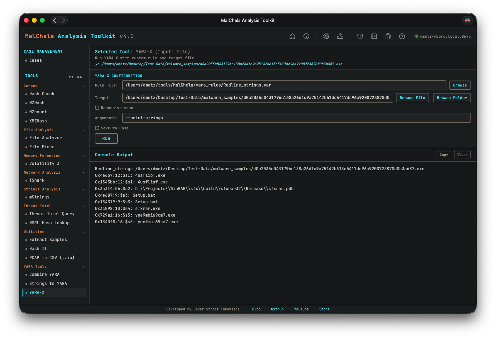

# Installing and Configuring YARA-X



<p align="center"><strong> YARA-X </p>

---

[YARA-X](https://virustotal.github.io/yara-x/) is VirusTotal's Rust rewrite of YARA.  MalChela uses it in two separate ways, and only the second one needs anything installed:

- **The built-in engine.**  As of v4.4, every MalChela tool that matches YARA rules has the yara-x library compiled in: [YARA Scan](../coretools/yara_scan.md), File Analyzer, MZHash, XMZHash, MZcount, and mismatchminer.  There is nothing to install or configure.  For scanning with your own rules, start with **YARA Scan**: it takes the same arguments as `yr scan` for the common options, and saves reports to a case.
- **The YARA-X integration.**  An optional panel for running VirusTotal's own `yr` command-line scanner, with its full set of options.  Use it for what YARA Scan doesn't cover, such as compiled rules (`-C`), module data (`-x`), `--fast-scan`, `--profiling`, or `yr`'s other subcommands.  `yr` is a separate program, and building MalChela does not produce it.

## Installing `yr`

Pick one:

- **With Cargo** (you already have Rust if you built MalChela):

    ```bash
    cargo install yara-x-cli
    ```

    This puts `yr` in `~/.cargo/bin`, which rustup adds to your `PATH`.

- **From a release build:**  Download the archive for your platform from [github.com/VirusTotal/yara-x/releases](https://github.com/VirusTotal/yara-x/releases), extract it, and put `yr` in a directory on your `PATH`.

- **With Homebrew** (macOS):

    ```bash
    brew install yara-x
    ```

Confirm it runs:

```bash
yr --version
```

If `yr` is installed somewhere that isn't on the server's `PATH`, add its directory to `tool_paths` in `server_config.yaml`.

## Enabling the Panel

The YARA-X entry is already in `tools.yaml`, commented out under **Special Tools Integrations**.  Uncomment it:

```yaml
- name: YARA-X
  description: "Run YARA-X with custom rule and target file"
  command: ["yr"]
  input_type: file
  file_position: "last"
  category: "YARA Tools"
  optional_args: []
  exec_type: binary
  cargo: false
```

Keep `command: ["yr"]` as written.  The web interface recognizes `yr` and opens the YARA-X panel in place of the generic tool form: a rules path, a target file or folder, a recursive option, and extra arguments.  After a restart, it appears under **YARA Tools** and is counted under **Integrations** on the home page.

## Using YARA-X Rules

- The panel runs `yr scan [--recursive] [extra args] <rules> <target>`.
- The rules path is usually a single `.yar` or `.yara` file.  `yr` also accepts a folder of rules, or you can merge a folder into one file first with **Combine YARA**.
- YARA-X is highly compatible with YARA, but it doesn't support every legacy module or construct.  `yr check <rules>` reports any rules that won't compile.

## Tips

- See the [YARA-X documentation](https://virustotal.github.io/yara-x/docs/) for command-line options and the differences from YARA.
